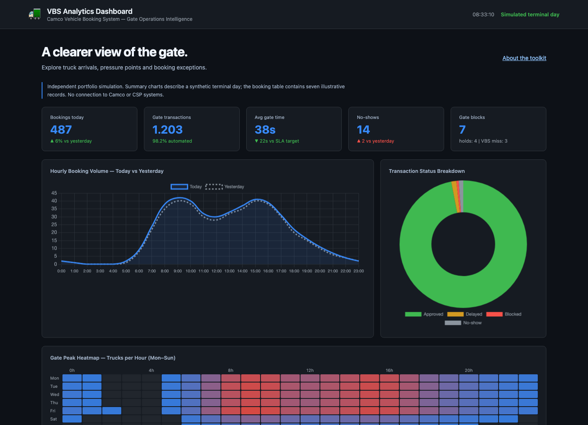
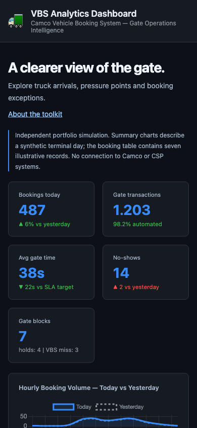

# CSP Zeebrugge — IT Developer Toolkit

[](https://github.com/phlppgdfry/csp-zeebrugge-toolkit/actions/workflows/portfolio-pages.yml)

## Interactive portfolio

**[Open the demo](https://phlppgdfry.github.io/csp-zeebrugge-toolkit/)** · [Two-minute walkthrough](docs/PORTFOLIO.md) · [Verification notes](docs/VERIFICATION.md)

No credentials required. The public demo uses synthetic sample data; it is an
independent portfolio project, not an operating terminal or ERP environment.



<details><summary>Mobile preview</summary>



</details>

---

[](https://github.com/phlppgdfry/csp-zeebrugge-toolkit/actions/workflows/ci.yml)

Three modules modelling the IT landscape of a **Navis N4 container terminal**: TOS extension patterns, vehicle-booking analytics and Oracle-style warehouse reporting. This independent portfolio uses synthetic data and local SDK fixtures.

---

## Modules

### 1. [`n4-groovy-extensions/`](./n4-groovy-extensions/)
Navis N4 code extensions written in Groovy — the exact mechanism N4 uses for customisation. Includes independently testable hook patterns for container validation, gate workflow interception, and reefer monitoring.

### 2. [`vbs-analytics/`](./vbs-analytics/)
Live browser dashboard for Camco VBS gate data: truck booking volumes, peak hour heatmap, gate transaction KPIs, and SLA tracking. Pure HTML/JS — open `index.html` and it runs.

### 3. [`bi-reporting/`](./bi-reporting/)
Oracle SQL datawarehouse schema + KPI queries designed to sit between N4 and a BI tool (Power BI / Tableau). Includes a Python script that generates automated daily CSV and chart reports.

---

## Tests

`n4-groovy-extensions/` ships a Spock test suite covering all three hooks — 28 specs,
run on every push via GitHub Actions (see badge above).

```
gradle test
```

## Stack

| Module | Technologies |
|---|---|
| N4 Groovy Extensions | Groovy, Java interop, Navis N4 SDK patterns |
| VBS Analytics | HTML5, CSS3, JavaScript, Chart.js |
| BI Reporting | Oracle SQL, Python, pandas, matplotlib |

---

## How it fits together

```
Navis N4 (TOS)
    │
    ├── Groovy hooks (this repo: n4-groovy-extensions)
    │       Validate containers, intercept gate events, monitor reefers
    │
    ├── Camco VBS — gate bookings feed
    │       Analysed in: vbs-analytics dashboard
    │
    └── Oracle DB — operational data
            Queried in: bi-reporting SQL + Python
```

This mirrors how a terminal IT developer actually works: extending the TOS, consuming data from connected systems, and building reporting on top.

---

**Contact:** Philippe Godfroy | [philippegodfroy.com](https://philippegodfroy.com) | [linkedin.com/in/philippe-godfroy](https://linkedin.com/in/philippe-godfroy) | philippe.godfroy@hotmail.com
